<div align="center">

# 🏋️ My Academy

**Workouts, personal trainers and gyms in one app.**
Students log their training, personal trainers follow their students, and gym owners run memberships and payments.

[](app/)
[](api/)
[](api/)
[](api/prisma/schema.prisma)
[](docker-compose.yml)
[](docker-compose.yml)
[](api/vitest.config.ts)

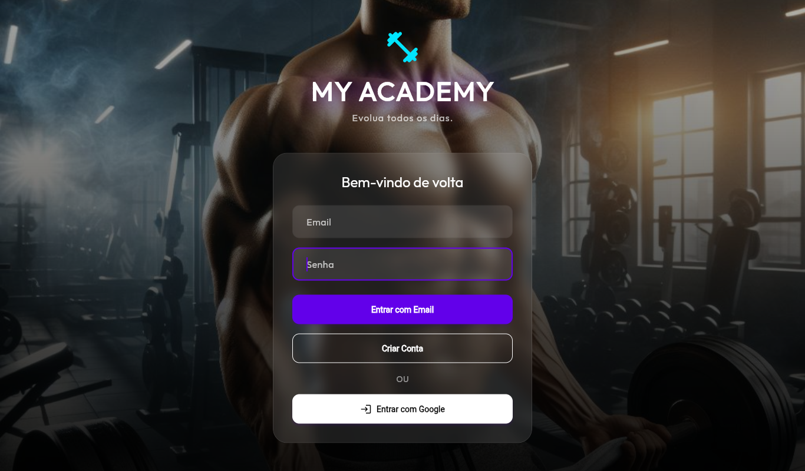

</div>

---

## ✨ One app, three roles

| 🧑‍🎓 Student | 🧑‍🏫 Personal trainer | 🏢 Gym owner |
|---|---|---|
| Build workout plans from an exercise catalog with GIFs | Contract students and see them in one list | Create a gym and its membership plans |
| Guided workout player: sets, fractional loads (22.5 kg), RPE, rest timer | Prescribe workouts and record physical assessments | Enroll students and track their memberships |
| Dashboard with weekly goal, volume, streak and charts | Uses every student feature for their own training | Record payments: pending → paid → overdue |
| Calendar, progress analytics and personal records | | Dashboard: active members, monthly revenue, overdue payments |

Onboarding asks for the role once and saves it on the server, so a new device skips it.

## 📸 Screenshots

### Student (mobile)

<table>
  <tr>
    <td align="center"><br><sub>Login</sub></td>
    <td align="center">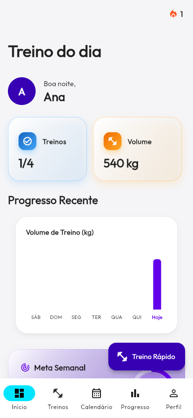<br><sub>Home dashboard</sub></td>
    <td align="center">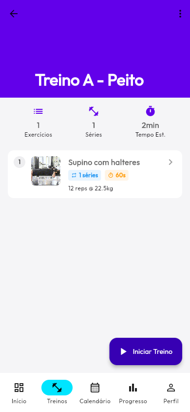<br><sub>Workout plan</sub></td>
    <td align="center">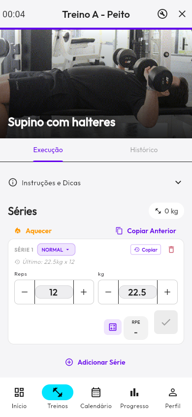<br><sub>Workout player</sub></td>
  </tr>
  <tr>
    <td align="center">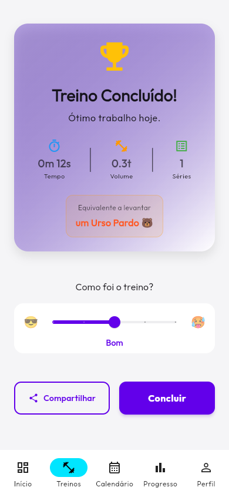<br><sub>Workout summary</sub></td>
    <td align="center">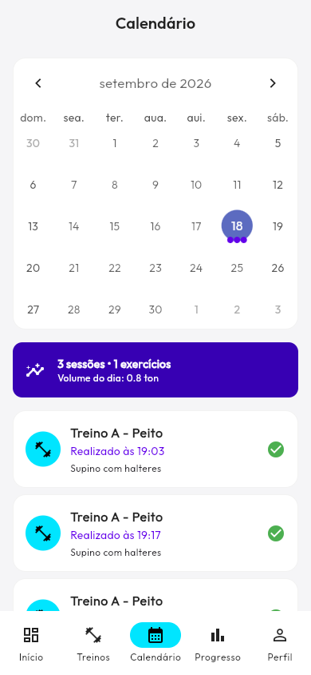<br><sub>Calendar</sub></td>
    <td align="center">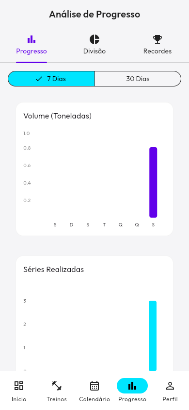<br><sub>Progress</sub></td>
    <td align="center">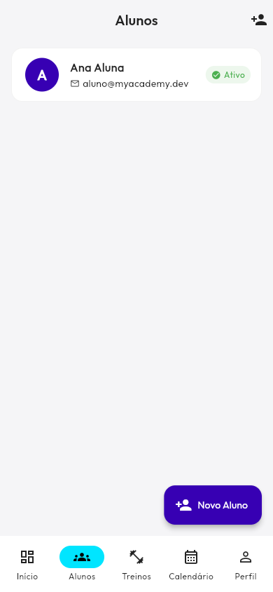<br><sub>Personal trainer · students</sub></td>
  </tr>
</table>

### Desktop

On wide screens the bottom bar becomes a side navigation rail and content is centered.

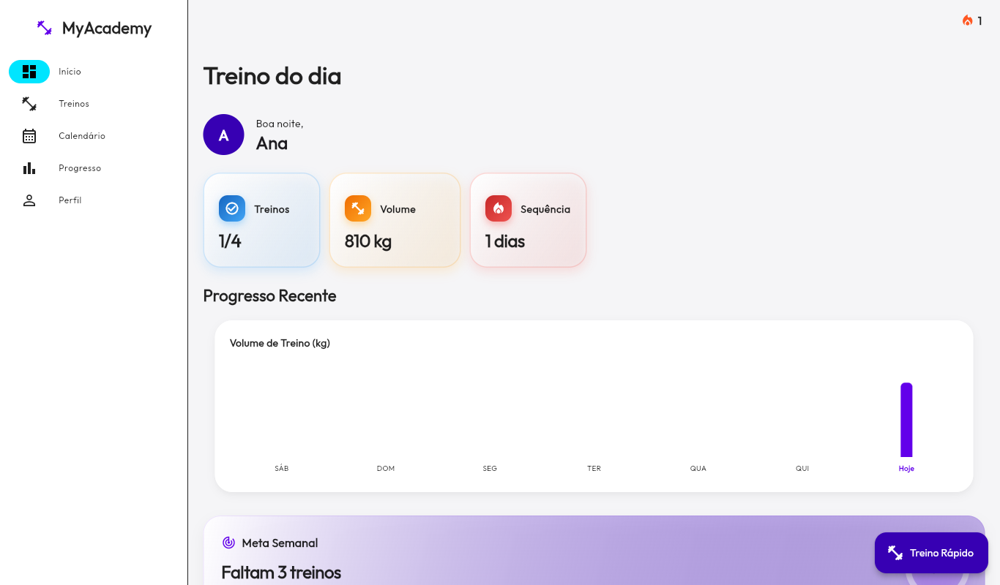

<table>
  <tr>
    <td align="center">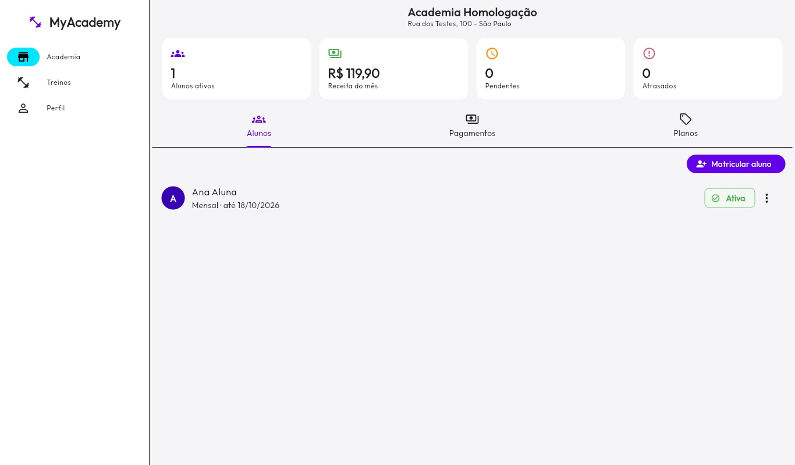<br><sub>Gym owner · members</sub></td>
    <td align="center">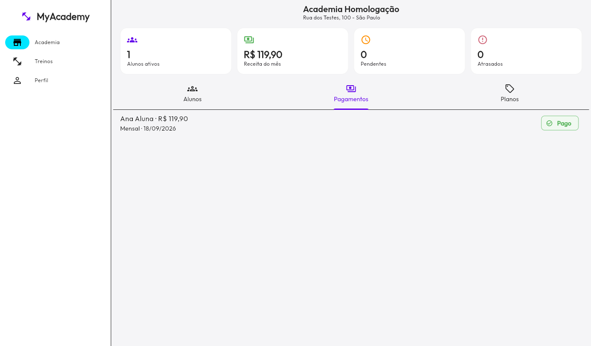<br><sub>Gym owner · payments</sub></td>
  </tr>
</table>

## 🧱 Architecture

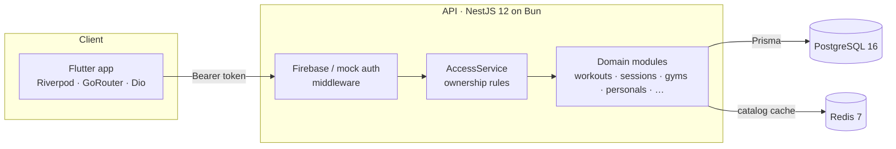

| Path | What lives there |
|---|---|
| [`api/`](api/) | NestJS 12 (ESM, TypeScript 6) on Bun, Prisma 7 + `@prisma/adapter-pg`, Redis cache, OpenAPI docs |
| [`app/`](app/) | Flutter with Clean Architecture per feature (`data` / `domain` / `presentation`) and Riverpod |
| [`docker-compose.yml`](docker-compose.yml) | Local stack: Postgres, Redis and the seeded API |

**Authorization:** users act on their own data, personal trainers on their contracted students, gym owners on their gyms. Catalog writes (exercises, methods) are ADMIN-only.

## 🚀 Quick start

**Requirements:** Docker, plus Flutter (stable) to run the app.

```bash
# 1. API + Postgres + Redis, seeded with test personas and mock auth
docker compose up -d --build
curl -fsS http://localhost:9000/health        # {"status":"ok"}

# 2. Flutter app pointing to the local API, with persona login
cd app
flutter pub get
flutter run -d chrome \
  --dart-define=USE_MOCK_AUTH=true \
  --dart-define=API_BASE_URL=http://localhost:9000/api/
```

API docs: <http://localhost:9000/reference> (Scalar) · <http://localhost:9000/docs> (Swagger UI).

### Test personas

With mock auth, sign in with any password:

| Email | Role | What to try |
|---|---|---|
| `aluno@myacademy.dev` | Student | Create a workout, run the player, check the dashboard and calendar |
| `personal@myacademy.dev` | Personal trainer | Students tab, prescriptions, assessments |
| `dono@myacademy.dev` | Gym owner (ADMIN) | Owns "Academia Homologação": plans, enrollments, payments |
| `novo@myacademy.dev` | New user | Full onboarding flow |

Direct API calls use `Authorization: Bearer mock-token:<uid>`, where the uid is one of `hml-student`, `hml-personal`, `hml-owner` or `hml-newbie`.

## 🧪 Quality gates

| Scope | Command | Gate |
|---|---|---|
| API unit | `cd api && bun run test:cov` | Vitest, **100 %** coverage threshold |
| API types + lint | `bun run typecheck && bun run lint` | tsc + ESLint 10 |
| API e2e (mocked) | `bun run test:e2e` | Controllers and pipes end to end |
| API e2e (real DB) | `bun run test:e2e:db` | Persona journeys against Docker Postgres + Redis |
| App | `cd app && flutter analyze && flutter test` | Lints + widget/unit tests |

Tests run with at most 2 workers so they don't overload the machine.

## 📚 More docs

- [`api/README.md`](api/README.md): API setup, environment variables, Prisma
- [`BUSINESS_RULES.md`](BUSINESS_RULES.md): domain rules
- [`SECURITY.md`](SECURITY.md): how to report vulnerabilities
- [`validation_note.md`](validation_note.md): latest homologation run and fixed bugs
